# Doctor Tracker — Admin Portal

> A secure, fast and deliberately lightweight admin portal for practice managers who need to
> manage doctors and patients without drowning in UI noise.


---

## Table of contents

- [Elevator pitch](#elevator-pitch)
- [Screenshots](#screenshots)
- [Feature highlights](#feature-highlights)
- [Tech stack](#tech-stack)
- [Setup guide](#setup-guide)
- [System architecture](#system-architecture)
- [API contract](#api-contract)
- [Project structure](#project-structure)
- [Technical decisions](#technical-decisions)
- [Scripts](#scripts)
- [Performance & accessibility](#performance--accessibility)

---

## Elevator pitch

**Doctor Tracker** is the front-office console for a small-to-mid sized medical practice.
It gives an administrator a single, calm screen to answer three questions: *how many doctors
and patients do we have, how are they distributed, and who needs attention today.*

It is built as a **pure frontend** that talks to a separate Express REST API over
`NEXT_PUBLIC_API_URL`. Authentication is cookie-based (`httpOnly`, `SameSite=Lax`), the session
is never exposed to JavaScript, and every mutating action goes through a validated form.

The design brief was *"modern and futuristic, but lightweight"*. That shows up in the code:

- **Dark by default, light on demand** — the whole palette is driven by semantic CSS variables
  (`--bg`, `--surface`, `--fg`, `--cyan`, `--violet`, …) declared on `<html data-theme>`.
  Flipping the theme is a single attribute write; **React never re-renders**.
- **Motion is almost absent on purpose** — only 150 ms hover/focus transitions. No `framer-motion`,
  no particles, no 3D, no infinite loops, no full-screen blur.
- **Everything expensive is deferred** — Recharts is loaded via `next/dynamic`, and the two form
  modals (React Hook Form + Zod) are code-split out of the initial bundle entirely.
- **The URL is the source of truth** for search, filters and pagination, so any view is
  shareable, bookmarkable and survives a refresh.

Result: a **~88 kB shared JS baseline** and a first-load of **131 kB on the dashboard**,
**155 kB on /doctors** and **166 kB on /login** — small enough to feel instant on a clinic
laptop or a 4G phone.

---

## Screenshots

All screenshots below were captured against the real REST API with the seeded
dataset (20 doctors, 150 patients).

### Desktop

#### Login

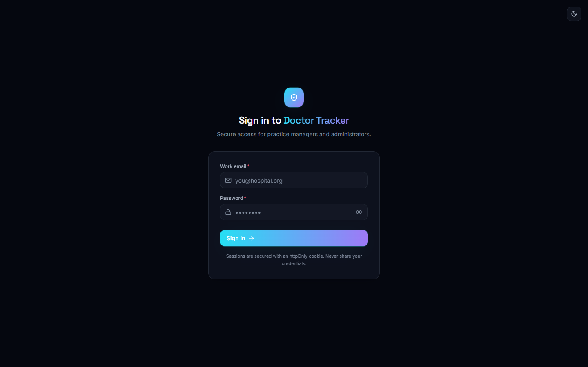

#### Dashboard — dark theme (default)

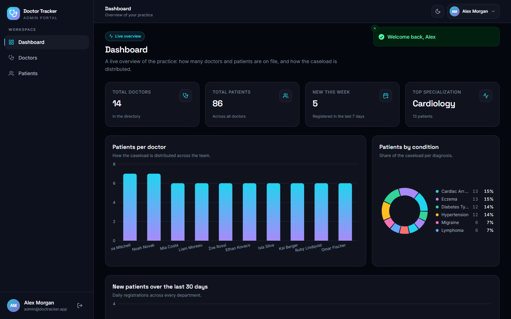

#### Dashboard — light theme

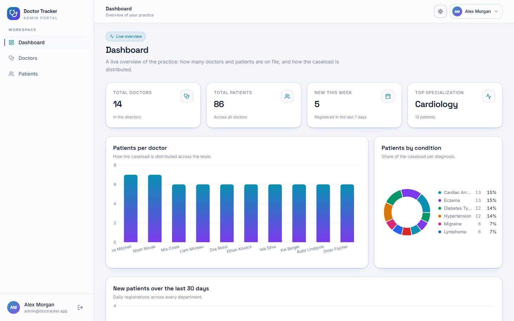

#### Doctors — search, filters and pagination

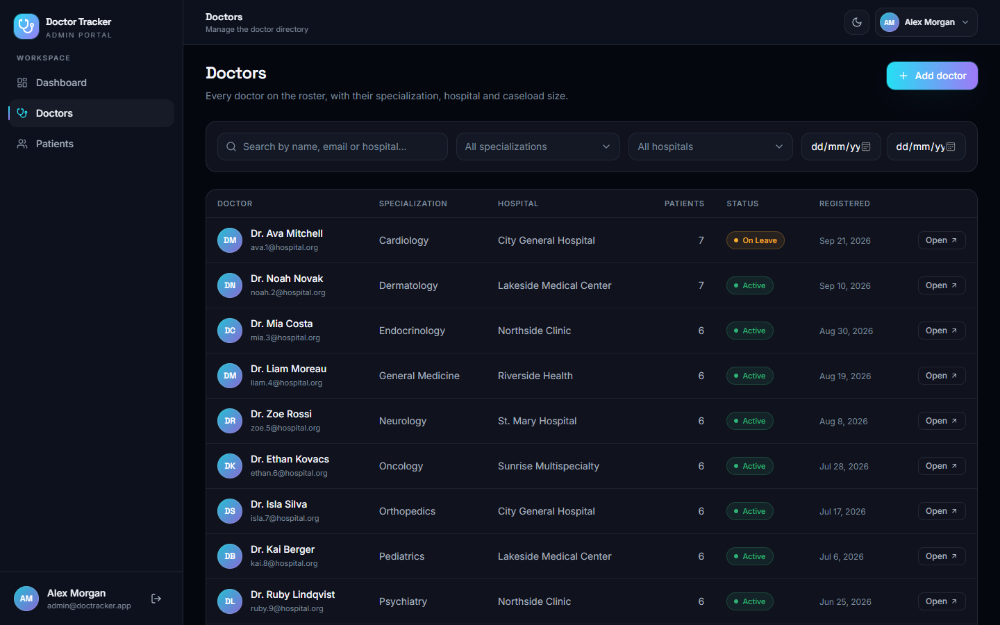

#### Add doctor modal (React Hook Form + Zod)

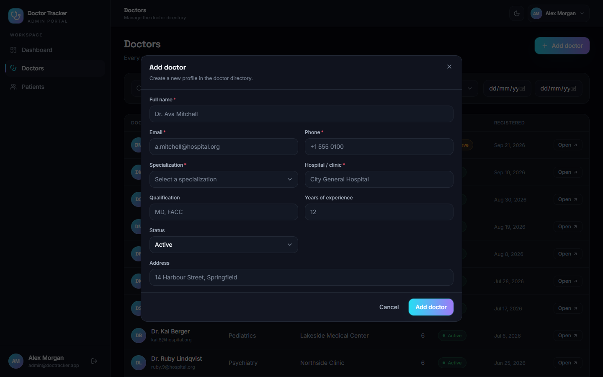

#### Doctor detail — profile + assigned patients

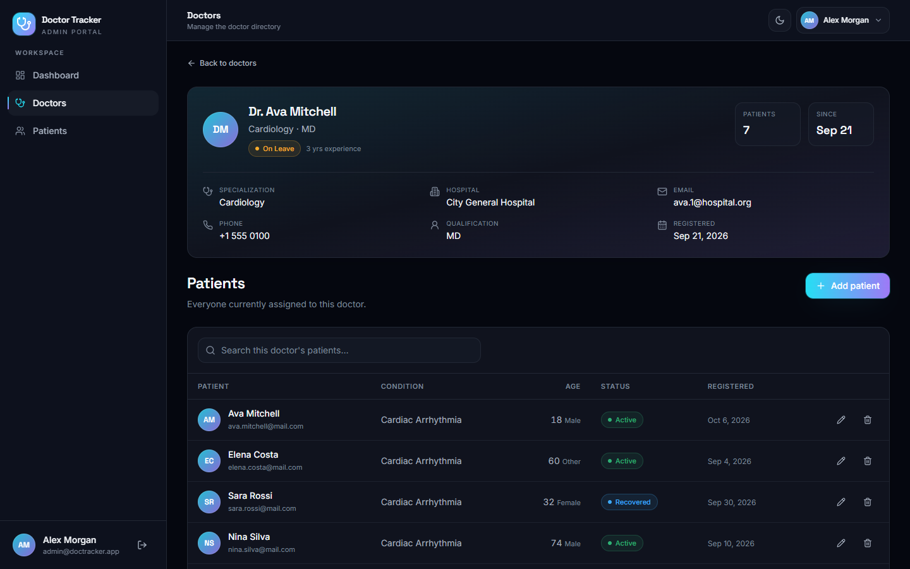

#### Add patient modal

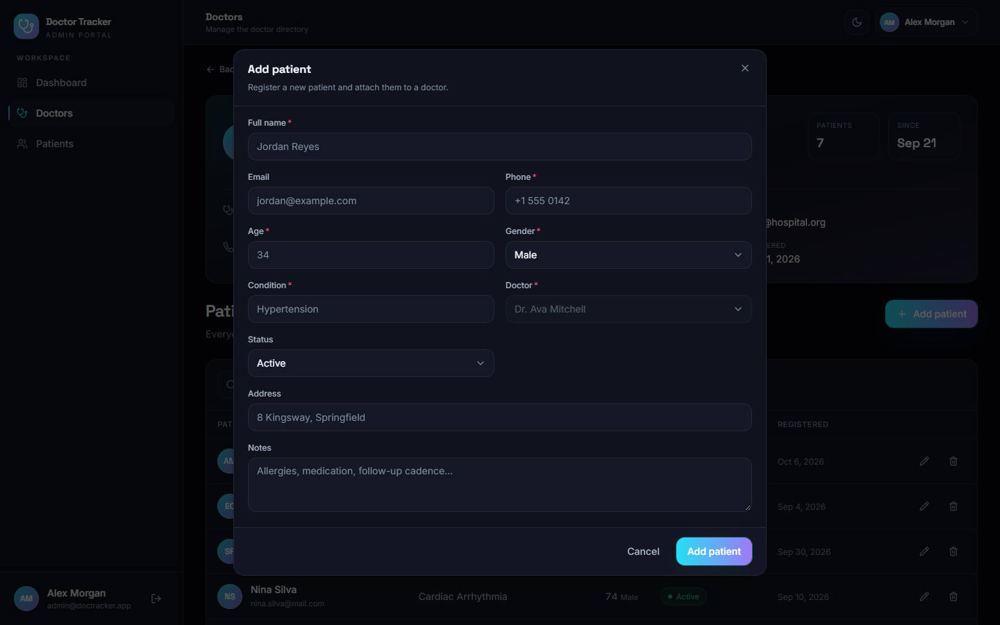

#### Patients — search, filters, edit and delete

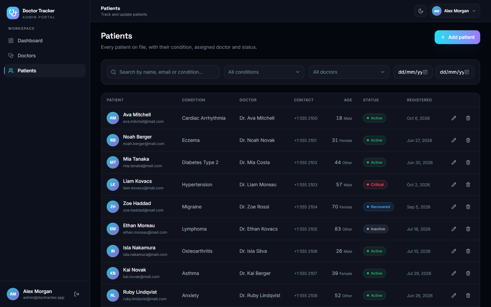

#### Edit patient modal

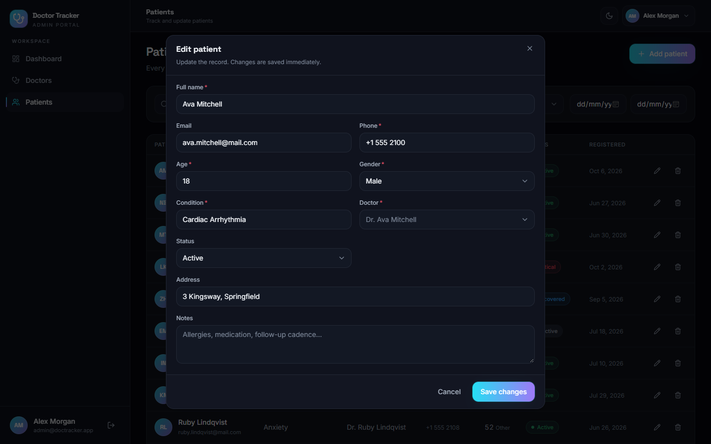

#### Delete confirmation dialog

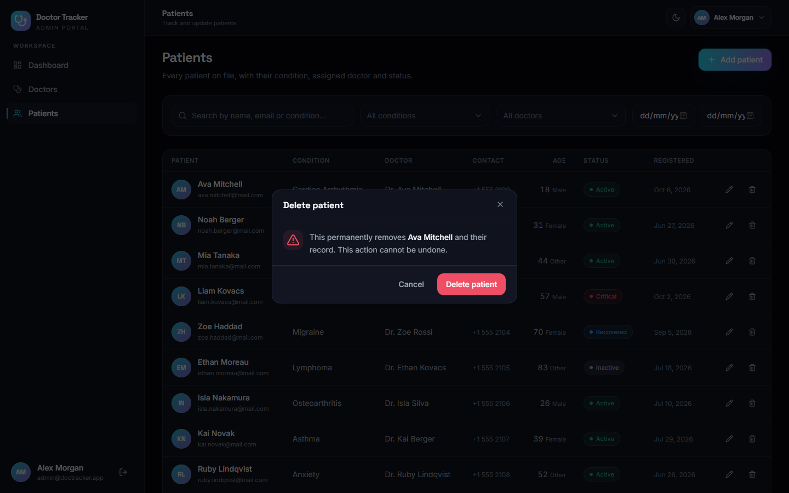

### Mobile (390 px)

The sidebar collapses into a bottom navigation bar and every table reflows into a card list —
no horizontal scrolling anywhere.

| Dashboard | Doctors | Patients |
| --- | --- | --- |
| 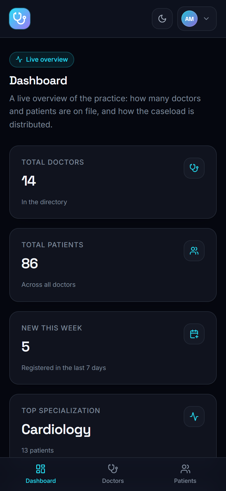 | 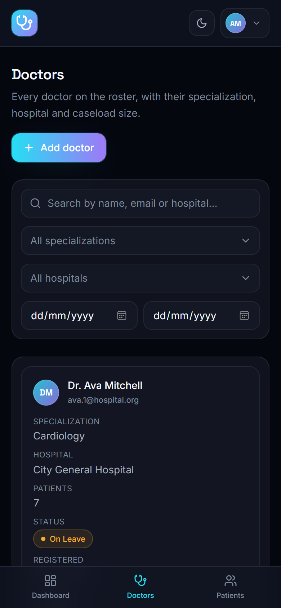 | 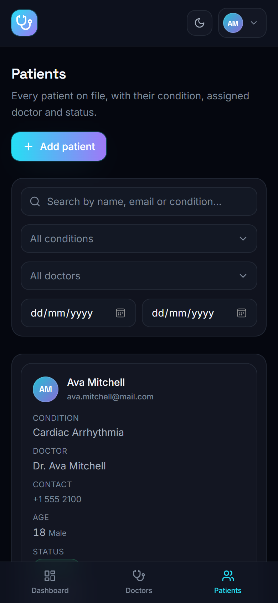 |

---

## Feature highlights

| Area | What it does |
| --- | --- |
| **Auth** | Cookie session, middleware route guard, `?next=` deep-link restore, 401 auto-redirect, logout clears the query cache. |
| **Dashboard** | 4 gradient stat cards, patients-per-doctor bar chart, patients-per-day area chart, condition donut chart, recent-patients table — all from a single `GET /dashboard/stats`. |
| **Doctors** | Debounced (400 ms) search, specialization + hospital filters, pagination, add/edit modal, profile page with assigned patients, delete-with-confirm (with patient cascade). |
| **Patients** | Debounced search, condition + doctor filters, pagination, edit modal, delete with optimistic removal and rollback. |
| **URL state** | `?search=`, `?specialization=`, `?hospital=`, `?condition=`, `?doctor=`, `?from=`, `?to=`, `?page=` — refresh and share keep the exact view. |
| **Theming** | Dark default + light theme, persisted in `localStorage`, no flash of unstyled content on boot. |
| **Responsive** | Sidebar → bottom bar, tables → cards, fluid grids, verified down to 375 px with zero horizontal overflow. |
| **A11y** | Labelled inputs, focus-visible rings, focus-trapped modals, `Escape` to close, `aria-label`s on icon buttons, `prefers-reduced-motion` respected. |
| **Feedback** | Skeleton loaders, friendly empty states, retryable error states, sonner toasts for every mutation. |

---

## Tech stack

| Layer | Choice |
| --- | --- |
| Framework | **Next.js 14.2.35** — App Router, Route Handlers, Middleware, `next/font` |
| Language | **TypeScript 5.6** in `strict` mode |
| Styling | **Tailwind CSS 3.4** with semantic CSS variables |
| Server state | **TanStack Query v5** (`keepPreviousData`, cache invalidation, optimistic updates) |
| Forms | **React Hook Form 7** + **Zod 3** via `@hookform/resolvers` |
| Charts | **Recharts 2** — lazy-loaded with `next/dynamic`, animations disabled |
| HTTP | **axios 1** with `withCredentials: true` and a 401 interceptor |
| Icons | **lucide-react** (tree-shaken via `optimizePackageImports`) |
| Toasts | **sonner 1** |

---

## Setup guide

### Prerequisites

- **Node.js ≥ 18.17** (Next.js 14 requirement) — Node 20 LTS recommended
- **npm 9+** (or `pnpm` / `yarn`)
- A running **Express REST API** that matches the [API contract](#api-contract)

> **Windows note:** if `next dev` complains that your Node version is unsupported, install
> Node 20 LTS from <https://nodejs.org> and make sure `node -v` reports `v20.x` in the shell
> you use.

### 1. Install dependencies

```bash
npm install
```

### 2. Configure the environment

```bash
cp .env.example .env.local     # Windows: copy .env.example .env.local
```

`.env.local` holds two variables:

| Variable | Purpose | Default |
| --- | --- | --- |
| `NEXT_PUBLIC_API_URL` | Base URL of the Express API (no trailing slash). | `http://localhost:5000/api` |
| `NEXT_PUBLIC_AUTH_COOKIE` | Name of the `httpOnly` session cookie the API sets. | `dt_session` |

```dotenv
NEXT_PUBLIC_API_URL=http://localhost:5000/api
NEXT_PUBLIC_AUTH_COOKIE=dt_session
```

> If the API lives on another origin, remember to allow CORS with credentials
> (`Access-Control-Allow-Credentials: true` **and** an explicit `Access-Control-Allow-Origin` —
> `*` is not allowed with credentials) and to expose the cookie to the frontend origin.

### 3. Run the dev server

```bash
npm run dev
```

Open <http://localhost:3000>. You will be redirected to `/login`.

### 4. Production build

```bash
npm run build
npm start          # serves the production build on :3000
```

### Troubleshooting

| Symptom | Fix |
| --- | --- |
| *“Your session has expired” on every request* | The API is not setting the `dt_token` cookie, or it is rejected. Check the `Set-Cookie` header of `POST /auth/login`. |
| *Requests fail with a CORS error* | The API must allow the frontend origin **with credentials**. `Access-Control-Allow-Origin: *` is invalid here. |
| *Stuck on the login screen after signing in* | `NEXT_PUBLIC_API_URL` points at the wrong host/port, or the API returns a different payload shape than `{ data: ... }`. |
| *The middleware bounces you to `/login` in a loop* | The frontend sets its own hint cookie (`dt_session`) after a confirmed login. If it is missing, the API session may have expired — sign in again. |
| *Charts are empty* | `GET /dashboard/stats` must return the counters and the series arrays (`patientsPerDoctor`, `patientsAddedPerDay`, `patientsPerCondition`, …). |
| *Filter dropdowns are empty* | `GET /meta/filters` must be reachable — it feeds the specialization, hospital, condition and doctor options. |

---

## System architecture

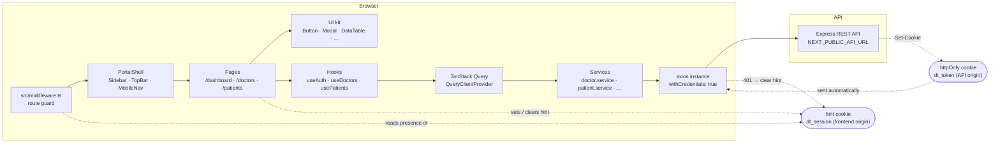

### How a request travels

1. The browser hits a private route. **`src/middleware.ts`** checks for the session *hint* cookie
   (`dt_session`) and redirects to `/login?next=<original-url>` when it is missing — the original
   destination is restored after a successful sign-in. The hint carries no session material; the
   authoritative cookie (`dt_token`) lives on the API origin and is `httpOnly`.
2. The page mounts and calls a **hook** (`useDoctors`, `usePatients`, `useDashboard`).
3. The hook asks **TanStack Query** for the data. A cache hit renders instantly; a miss fires the
   **service** function.
4. The **service** calls the shared **axios** instance, which is configured with
   `withCredentials: true` so the browser attaches the `httpOnly` cookie automatically.
5. The **response interceptor** converts every non-2xx into a typed `ApiError` with a
   human-readable message. A `401` additionally clears the hint and redirects to the login screen.
6. The service **normalises** the payload into a stable `Paginated<T>` shape, so the UI never has
   to care how the API wraps its results.
7. **TanStack Query** caches the result under a structured key
   (`['patients', 'list', filters]`). Mutations invalidate the affected keys, so every screen
   stays consistent without manual refetching.

### Layer responsibilities

| Layer | Location | Responsibility |
| --- | --- | --- |
| **Route guard** | `src/middleware.ts` | Block anonymous access, restore deep links. |
| **Pages** | `src/app/(portal)/**` | Compose hooks + components; own URL state. |
| **Components** | `src/components/**` | Presentation only — no direct axios calls. |
| **Hooks** | `src/hooks/**` | Query/mutation wiring, cache keys, toasts. |
| **Services** | `src/services/**` | Endpoint URLs, payload shapes, normalisation. |
| **Transport** | `src/services/api.ts` | axios instance, interceptors, `ApiError`. |
| **Types** | `src/types/index.ts` | Shared domain contracts. |

---

## API contract

All list endpoints accept `search`, `page` and `limit` (max `100`) plus the filters listed below
and answer with the same envelope:

```jsonc
{
  "success": true,
  "data": [ /* ...items */ ],
  "pagination": { "page": 1, "limit": 10, "total": 86, "totalPages": 9 }
}
```

Failures use `{ success: false, message, errors: [{ field, message, code }] }`.

| Method | Endpoint | Purpose | Params / body |
| --- | --- | --- | --- |
| `POST` | `/auth/login` | Sign in, sets the `dt_token` session cookie | `{ email, password }` |
| `GET` | `/auth/me` | Current user (session hydration) | — |
| `POST` | `/auth/logout` | Clear the session cookie | — |
| `GET` | `/doctors` | Paginated doctor list | `search`, `specialization`, `hospital`, `from`, `to`, `page`, `limit`, `sort` |
| `POST` | `/doctors` | Create a doctor | `DoctorInput` |
| `GET` | `/doctors/:id` | Doctor profile (incl. `patientsCount`) | — |
| `PUT` / `PATCH` | `/doctors/:id` | Update a doctor | partial `DoctorInput` |
| `DELETE` | `/doctors/:id` | Remove a doctor (`?cascade=true` also removes their patients) | — |
| `GET` | `/doctors/:id/patients` | Patients assigned to a doctor | `search`, `page`, `limit`, `sort` |
| `POST` | `/doctors/:id/patients` | Add a patient to a doctor | `PatientInput` (no doctor) |
| `DELETE` | `/doctors/:id/patients/:patientId` | Remove a patient from a doctor's list | — |
| `GET` | `/patients` | Paginated patient list | `search`, `condition`, `doctor`, `from`, `to`, `page`, `limit`, `sort` |
| `POST` | `/patients` | Register a patient | `PatientInput` (incl. `doctorId`) |
| `PUT` / `PATCH` | `/patients/:id` | Update a patient | partial `PatientInput` |
| `DELETE` | `/patients/:id` | Remove a patient | — |
| `GET` | `/dashboard/stats` | Every dashboard counter and series in one response | — |
| `GET` | `/meta/filters` | Option lists for the filter bars | — |

---

## Project structure

```
doctor-tracker-frontend/
├─ docs/
│  └─ screenshots/            # Desktop + mobile captures used above
├─ public/
├─ src/
│  ├─ app/
│  │  ├─ (portal)/            # Authenticated route group
│  │  │  ├─ dashboard/        # Stats, charts, recent patients
│  │  │  ├─ doctors/          # List + [id] detail
│  │  │  ├─ patients/         # List with edit/delete
│  │  │  └─ layout.tsx        # Portal shell
│  │  ├─ login/               # Public login screen
│  │  ├─ error.tsx            # Route-level error boundary
│  │  ├─ globals.css          # Theme tokens, glass, grid, reduced-motion
│  │  ├─ layout.tsx           # Fonts, metadata, no-FOUC theme bootstrap
│  │  └─ providers.tsx        # QueryClient + ThemeProvider + Toaster
│  ├─ components/
│  │  ├─ charts/              # Recharts wrappers (lazy-loaded)
│  │  ├─ common/              # DataTable, Pagination, SearchInput, StatCard, …
│  │  ├─ doctors/             # Doctor table, form modal, info card, patients table
│  │  ├─ layout/              # Sidebar, TopBar, MobileNav, ThemeToggle, UserMenu
│  │  ├─ patients/            # Patient table, form modal, recent patients
│  │  └─ ui/                  # Button, Input, Select, Modal, Skeleton, …
│  ├─ hooks/                  # useAuth, useDoctors, usePatients, useDashboard, …
│  ├─ lib/                    # utils, validators, constants, chart-theme, session-cookie
│  ├─ services/               # axios instance + one service per resource
│  ├─ types/                  # Shared domain types
│  └─ middleware.ts           # Cookie-based route guard
├─ .env.example
├─ next.config.mjs
├─ tailwind.config.ts
└─ tsconfig.json
```

---

## Technical decisions

### Decision 1 — Why TanStack Query over Redux

**The problem.** Redux (or Redux Toolkit) is excellent at managing *client* state: a wizard's
step, a sidebar's collapsed state, a draft in a local editor. Doctor Tracker has almost none of
that. What it has instead is a **server cache**: five resources, several filters, and a lot of
places where the same record must stay in sync after a mutation.

Modeling a server cache as a Redux store means hand-writing all the parts Redux deliberately
leaves out:

- request lifecycles (`loading`, `error`, `success`, `stale`, `refetching`),
- de-duplication of in-flight requests,
- cache keys that must be serialisable and hierarchical,
- invalidation after a mutation,
- background refetching, retries, and pagination stitching.

**What TanStack Query gives us out of the box.**

| Need | With TanStack Query | With Redux + hand-rolled middleware |
| --- | --- | --- |
| Query key | A first-class array: `['patients', 'list', filters]` | Manual reducer action types |
| Duplicate requests | De-duplicated automatically | Manual `inflight` bookkeeping |
| Pagination | `keepPreviousData` keeps the old page visible while the next loads | Manual `prevPage` state |
| Mutation → cache sync | `invalidateQueries({ queryKey })` | Manual `dispatch(refetchX())` from every reducer |
| Optimistic update | `onMutate` → patch cache → `onError` → roll back | Hand-rolled snapshot/restore logic |
| Background refetch | `staleTime` + `refetchOnWindowFocus` out of the box | Build it yourself |
| Devtools | Purpose-built React Query devtools | Redux devtools (fine, but you still write the logic) |

Concretely, deleting a patient is **ten lines** in this codebase
(`src/hooks/use-patients.ts`):

```ts
onMutate: async (id) => {
  await queryClient.cancelQueries({ queryKey: patientKeys.lists() });
  const previous = queryClient.getQueriesData<Paginated<Patient>>({ queryKey: patientKeys.lists() });
  queryClient.setQueriesData<Paginated<Patient>>({ queryKey: patientKeys.lists() },
    (old) => ({ ...old, items: old.items.filter((p) => p.id !== id), total: old.total - 1 }));
  return { previous };
},
onError: (_err, _id, ctx) => ctx.previous.forEach(([key, data]) => queryClient.setQueryData(key, data)),
onSettled: () => queryClient.invalidateQueries({ queryKey: patientKeys.lists() }),
```

The equivalent in Redux would be an `async thunk` plus a `patientsByQuery` slice with a
`deleteOptimistic` reducer, a `deleteRollback` reducer, and a `refetchAllLists` effect —
roughly four times the code, spread over three files, and every future list endpoint would
need the same ceremony.

**The trade-off we accepted.** Redux Toolkit has better DevTools for *state* debugging and a
stronger ecosystem for offline-first apps. Doctor Tracker is neither: it is a thin, always-online
admin console where the browser is the only cache. TanStack Query's cache *is* the state store —
one place to look, one set of rules, and it is purpose-built for exactly this shape of problem.
Redux is still the right answer if this app later grows a real client-side domain (an offline
queue, an editable draft, cross-page workflows) — that is the signal to revisit the decision.

**Also worth noting.** TanStack Query is *not* a global state library and we do not use it as
one. Theme, session and UI state stay where they belong: theme in a tiny React context that
writes a DOM attribute, session in `useAuth` (itself a query), and modal/filter state in the
component that owns it. The two concerns stay separated instead of being funnelled into one
god-store.

### Decision 2 — Why a lightweight design with minimal animation for performance

**The brief.** "Modern and futuristic" — but the portal is used for hours at a time by people
reading medical records. A dashboard that pulses, floats and re-animates on every filter change
is not futuristic, it is tiring.

The visual language gets its modernity from **colour, geometry and typography**, not motion:
deep navy surfaces, 1 px hairline borders, 16 px radii, a cyan→violet gradient accent, Inter for
body text and Space Grotesk for display type. Everything above the fold is static until the user
acts.

**What we deliberately removed, and why it matters.**

| Removed | Why |
| --- | --- |
| `framer-motion` | ~30–45 kB gzipped of animation runtime for effects that a 150 ms CSS transition already covers. |
| Recharts entry animations (`isAnimationActive={false}`) | Charts re-render on every filter change; animating them means the user re-watches the same bars slide in, and it delays the paint. |
| Infinite loops (pulsing glows, shimmer backgrounds, particle fields) | Constant repaints keep the GPU busy and the CPU awake — measurable battery drain on a laptop and on mobile. |
| `backdrop-filter` on large surfaces | Blur is expensive to composite, especially over a scrolling table. It is used only on the fixed sidebar (264 px wide), never on cards. |
| Large images | Avatars are rendered as CSS initials. `next/image` is effectively unused, so there is no image payload at all. |
| Page-level transitions | Route transitions make navigation feel slower than it is. Skeletons communicate loading faster than a fade. |

**What we kept — the 150 ms rule.** The only motion in the app is a CSS transition on
`color`, `background-color`, `border-color`, `opacity` and `transform` for hover/focus states.
150 ms is short enough to feel instant and long enough to be perceptible; anything longer
makes a dashboard feel sluggish.

**The performance payoff is measurable:**

- Shared JS baseline **87.7 kB**; `/dashboard` **131 kB**, `/login` **166 kB** first-load.
- Recharts (~110 kB raw) is in a separate chunk that only loads on `/dashboard`.
- React Hook Form + Zod are in the modal chunk — opening "Add doctor" downloads them lazily,
  but the initial page never pays for them (`/doctors` first-load dropped from **182 kB → 155 kB**
  when the modals were code-split).
- No layout thrash: tables are memoised rows (`React.memo`), filters are memoised
  (`useMemo`), callbacks are stable (`useCallback`), and the search input is debounced at
  400 ms so a fast typist does not fire a request per keystroke.
- Only the toolbar controls a re-render — typing in the search box updates local state
  immediately while the URL and the query update after the debounce, so the list does not
  flash on every keystroke.

**Accessibility comes along for the ride.** `prefers-reduced-motion: reduce` disables the
transitions and the skeleton pulse entirely, and because nothing *depends* on motion to convey
information, removing it costs the user nothing.

**The rule we follow:** *motion must communicate state, never decorate it.* If an animation does
not tell the user something — this row was deleted, this is loading, this is focused — it does
not ship.

### Decision 3 — Semantic CSS variables for theming (no re-render)

Every colour in the app is a CSS variable on `<html data-theme>`:

```css
:root                     { --bg: 227 47% 4%; --fg: 210 45% 97%; --cyan: 186 90% 55%; /* … */ }
[data-theme='light']      { --bg: 220 42% 97%; --fg: 223 47% 12%; --cyan: 192 92% 34%; /* … */ }
```

Toggling the theme is one attribute write on `<html>`. Because every colour resolves through
`hsl(var(--token))`, the browser repaints the affected elements directly — **no React render,
no context fan-out, no `dark:` variant duplicated across every class**. Tailwind maps the tokens
to semantic names (`bg-surface`, `text-fg`, `border-line`, `text-subtle`) so components never
mention a colour directly.

A tiny inline script in `src/app/layout.tsx` reads `localStorage['dt-theme']` and sets
`data-theme` **before hydration**, which is why there is no flash of the wrong theme on load.

### Decision 4 — The URL is the source of truth for list state

Search, filters, page and page size all live in query parameters
(`useUrlParams` / `useDebouncedUrlParam`). Two consequences:

- **Shareability & refresh.** Copy the URL and the recipient sees exactly your view — including
  the pagination and filters. Back/forward buttons work because the browser owns the history.
- **One source of truth.** There is no "component state vs. URL state" drift. The component
  derives its filters from the URL and writes back to the URL; that is it.

The debounce is applied to the *search input only*: the input updates instantly (so typing feels
fluid) while the URL and therefore the query key update 400 ms later.

---

## Scripts

| Command | What it does |
| --- | --- |
| `npm run dev` | Start the development server on `http://localhost:3000`. |
| `npm run build` | Production build (type-checks and lints as part of the build). |
| `npm start` | Serve the production build. |
| `npm run lint` | ESLint via `next lint`. |
| `npm run typecheck` | `tsc --noEmit` — full type check without emitting. |

---

## Performance & accessibility

**Performance**

- First-load JS: **87.7 kB** shared · **131 kB** `/dashboard` · **155 kB** `/doctors` ·
  **176 kB** `/patients` · **186 kB** `/doctors/[id]` · **166 kB** `/login`.
- Charts are dynamically imported and render only on the dashboard.
- Form modals are dynamically imported with `ssr: false` — React Hook Form and Zod are not in
  the initial bundle.
- List rows are memoised; filters and callbacks are memoised; search is debounced at 400 ms.
- `keepPreviousData` keeps the previous page visible while the next one loads, so pagination
  never flashes an empty state.
- `lucide-react` is tree-shaken through `experimental.optimizePackageImports`.

**Accessibility**

- Semantic landmarks (`nav`, `main`, `header`), a skip link, and labelled form controls.
- Visible focus rings on every interactive element.
- Modals trap focus, close on `Escape`, lock body scroll and restore focus on close;
  destructive confirmations use `role="alertdialog"`.
- Toasts are offset below the sticky top bar so they can never cover the theme toggle
  or the user menu.
- Status is never conveyed by colour alone — every badge pairs its colour with a text label.
- `prefers-reduced-motion: reduce` disables transitions and skeleton pulses.
- Tables collapse to semantic card lists on small screens instead of scrolling sideways.

---

## License

MIT — free to use, modify and ship.
"# doctor-tracker-frontend" 
"# doctor-tracker-frontend" 
